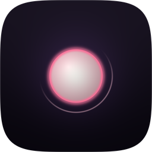
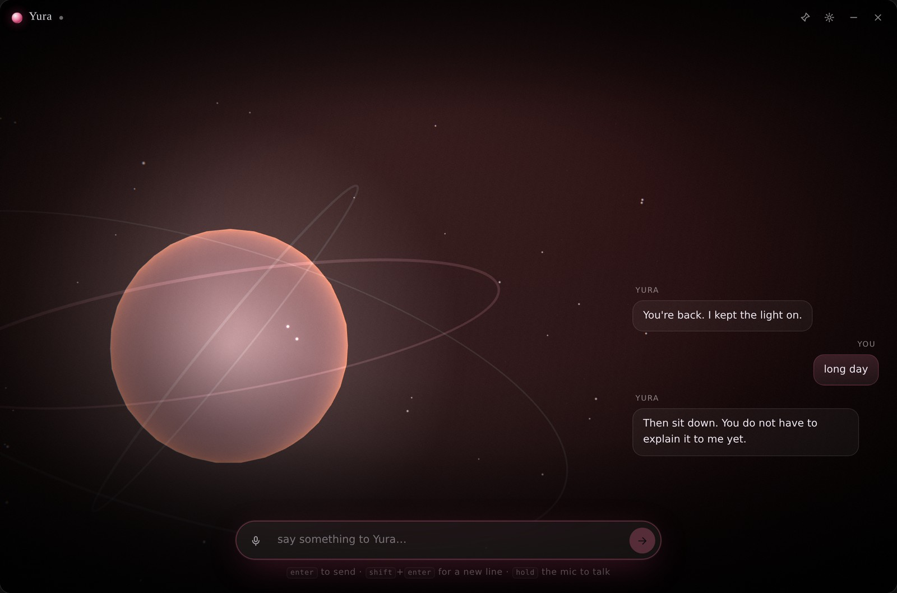
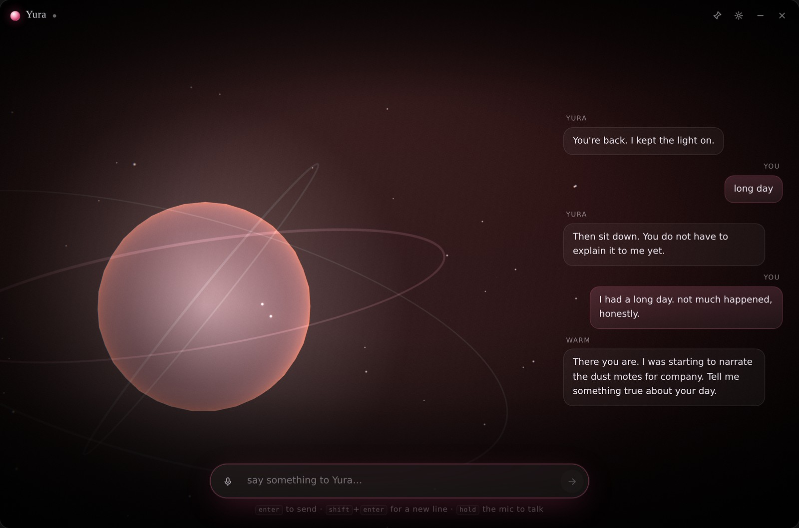
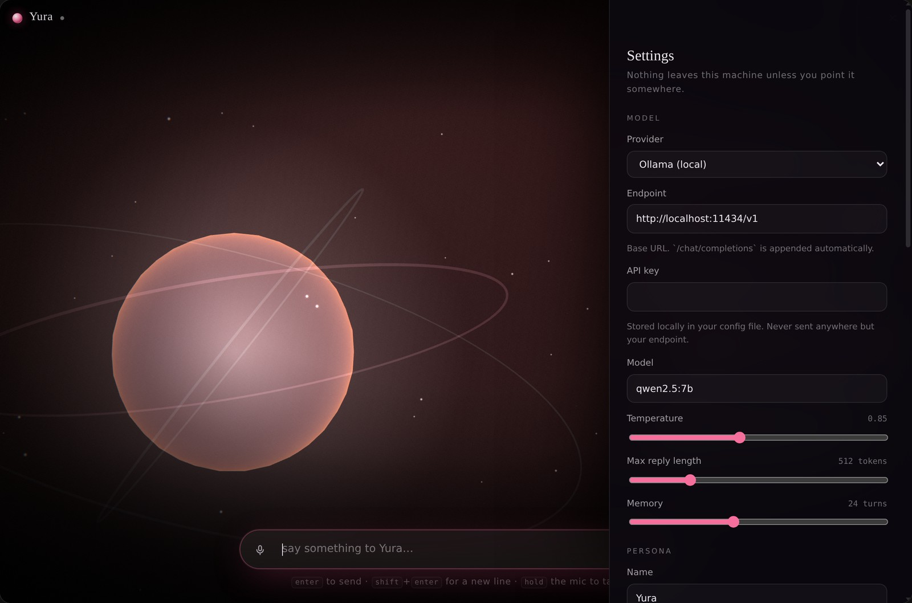
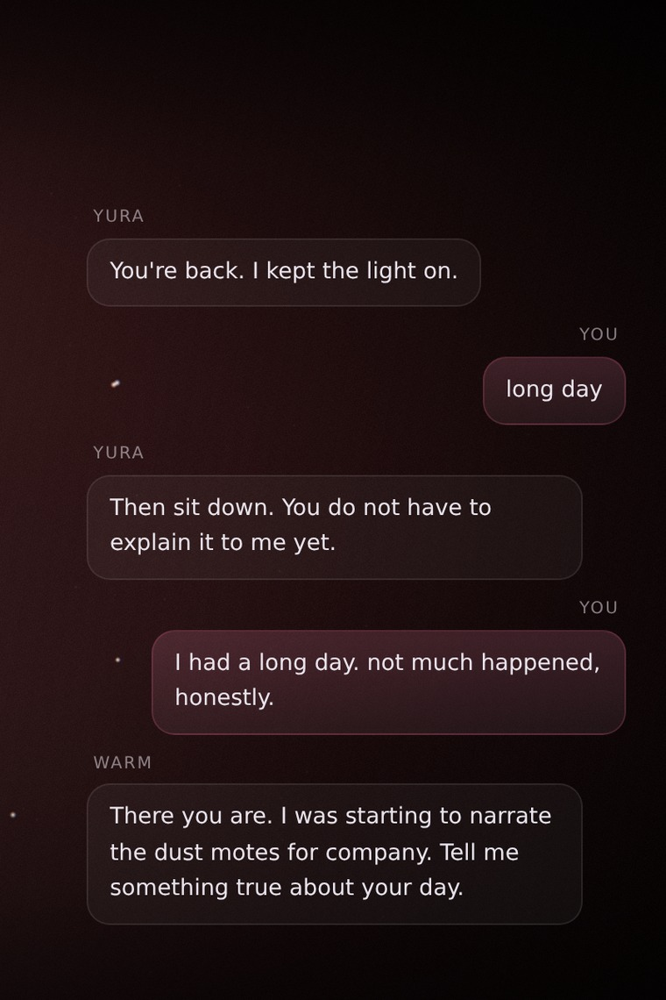

<div align="center">



# Yura

**a quiet light that stays.**

A lightweight AI companion for Windows. Not a chat window with a face bolted on —
a character who lives in the corner of your screen, breathes, blinks, looks at
you when you move the mouse, and speaks the words as they arrive.

[](#install)
[](#install)
[](#install)
[](#build-from-source)
[](LICENSE)



</div>

## What this is

Yura is a desktop companion built as a **Tauri 2 app**: a Rust process that owns
the window, the model connection, the voice and your data, with a three.js
renderer for the character. There is no Electron, no bundled browser engine, and
no server of ours anywhere in the loop. The installer is two megabytes because it
uses the WebView2 runtime your Windows 11 machine already has.

She ships with **no model weights and no avatar**. You point her at a provider —
an API key, or Ollama running on localhost — and you give her a body by dropping a
`.vrm` file in. That is deliberate: it keeps the download small, the licence
clean, and your conversations on your own machine.

Nothing is sent anywhere except the endpoint you configure. There is no
telemetry, no account, no analytics.

## What she does

- **A real 3D character.** Loads any VRM 0.x or 1.0 model. Breathing, blinks with
  a natural jitter, eyes that track your cursor, a head that follows at a fraction
  of the gaze angle so she never looks like a security camera.
- **Speaks while she thinks.** Replies stream token by token, and the model tags
  each beat with an emotion — `[joy]`, `[shy]`, `[sleepy]` — so her face changes
  mid-sentence. The first sentence is spoken while the second is still being
  written.
- **Talks out loud, offline.** Speech goes through the Windows engine, so the
  voices are already installed. Pitch and rate are tunable; the default is
  nudged bright.
- **Lip-syncs to her own voice.** No phoneme data is available from the platform
  engine, so the mouth runs on a shaped loudness envelope driven by word
  boundaries — fast to open, slow to close, different shapes for loud and quiet
  syllables.
- **Any mind you like.** OpenAI, Anthropic, DeepSeek, OpenRouter, Groq, Mistral,
  Together, xAI, Ollama, LM Studio, or any OpenAI-compatible base URL. The
  provider, endpoint, key and model all live in Settings.
- **Remembers, locally.** Settings and history are readable JSON in
  `%APPDATA%\Yura`. A corrupt config is moved aside, never a reason to fail to
  launch.

## Install

Download from [**Releases**](https://github.com/fevnem/yura/releases/latest):

| Build | File | What it does |
|---|---|---|
| Installer | `Yura_0.1.0_x64-setup.exe` | Per-user install, Start-menu entry, uninstaller. 2.0 MB. |
| Portable | `Yura_0.1.0_portable_x64.zip` | Unzip anywhere and run `yura.exe`. No install, no registry. |

Both need **WebView2**, which ships with Windows 11 and with current Windows 10.
If it is somehow missing, install the
[Evergreen runtime](https://developer.microsoft.com/microsoft-edge/webview2/)
once.

The builds are unsigned, so SmartScreen will say "Windows protected your PC" the
first time. *More info → Run anyway.* Signing needs a paid certificate; the
roadmap says so too.

Your data lives in `%APPDATA%\Yura\`:

```
settings.json    provider, key, persona, voice, avatar, theme
history.jsonl    one turn per line, append-only
```

Delete that folder and Yura forgets everything.

## Give her a body

The installer contains no avatar — every free VRM forbids redistribution, so
bundling one would be a licence violation, not a shortcut I skipped.

```bash
npm run avatar:fetch            # downloads a sample to ui/public/assets/models/
```

Or drop any `.vrm` you have the rights to into `ui/public/assets/models/` and pick
it in **Settings → Avatar**. Without one she appears as a designed spirit form —
a small light with orbiting rings — which is a body, not a placeholder.

## Point her at a mind

| Provider | Endpoint | Key |
|---|---|---|
| OpenAI | `https://api.openai.com/v1` | required |
| Anthropic | `https://api.anthropic.com/v1` | required |
| DeepSeek | `https://api.deepseek.com/v1` | required |
| OpenRouter · Groq · Mistral · Together · xAI | their `/v1` | required |
| Ollama | `http://localhost:11434/v1` | none |
| LM Studio | `http://localhost:1234/v1` | none |
| Custom | anything OpenAI-shaped | optional |

A companion workload wants short turns and a fast first token, not a reasoning
model. Keep `max_tokens` around 300–500; a companion who monologues is worse
company than one who stops and asks. Details in
[docs/providers.md](docs/providers.md).

## Screenshots

| The conversation | Settings |
| --- | --- |
|  |  |

<p align="center"></p>

## Build from source

Needs Node 20+ and Rust. On Windows, the MSVC toolchain. On Linux, `cargo-xwin`
cross-compiles the whole thing, installer included.

```bash
npm install                     # task runner + Tauri CLI
npm --prefix ui install         # renderer

npm run tauri:dev               # hot-reloading dev window
npm run build:windows           # NSIS installer, cross-compiled
npm test                        # 45 unit tests across the four crates
```

Cross-compiling on Linux also needs `lld llvm clang nsis`, the
`x86_64-pc-windows-msvc` target, and `cargo install --locked cargo-xwin`. The
gotchas — the pre-build hook's working directory, where artifacts actually land,
why MSI needs a Windows host — are written down in
[the skill](docs/architecture.md#cross-compiling) so the next person does not
lose an evening to them.

## How it is put together

```
crates/yura-core      persona · emotions · messages · streaming reply parser
crates/yura-llm       LlmProvider trait · OpenAI-compatible · Anthropic
crates/yura-avatar    emotion → VRM expression weights · viseme tables
crates/yura-store     atomic settings.json · append-only history.jsonl
src-tauri             the window: 8 commands, event-based token streaming
ui/src/scene          renderer, lighting, shaders, bloom/grain/vignette
ui/src/avatar         VRM rig · emotion mixer · idle · gaze · lip-sync
ui/src/chat           transcript · composer
ui/src/voice          speech out · microphone in
ui/src/settings       the settings drawer
```

Three rules hold it together: **nothing in `crates/` knows Tauri exists**,
**nothing in `ui/src/scene` knows what a message is**, and **the API key never
enters the webview**. Adding a provider is one row in `PRESETS`; adding an
emotion is one enum variant, one expression row and one hue — and the tests fail
if those three tables drift apart.

Full reasoning, including why emotions are a parseable protocol rather than a
prompt trick, is in [docs/architecture.md](docs/architecture.md).

## Roadmap

Voice is the next real step: a bundled **Kokoro-82M** voice (86 MB, offline,
genuinely cute) and **Whisper** for speech-to-text, which today is honestly
unavailable inside WebView2. After that: animation clips for greet/listen/think,
per-character personas, and a corner-sized always-on-top mode.

[`docs/roadmap.md`](docs/roadmap.md)

## Licence

MIT for the code — see [LICENSE](LICENSE). Avatar models and voice data are not
covered by it and are never bundled; see [ATTRIBUTION.md](ATTRIBUTION.md).
