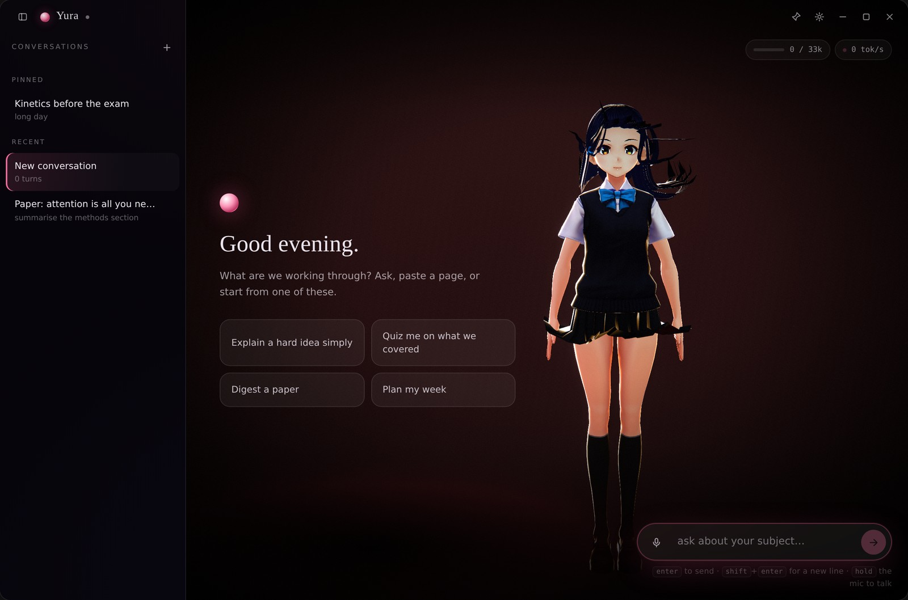

<div align="center">


# Yura

*<sub>a study companion who stays</sub>*

[](#install)
[](#install)
[](#install)
[](#build-from-source)
[](LICENSE)



</div>

A study and research companion for Windows. Not a chatbot with a face bolted on —
a character who sits beside you while you read, revise and write, keeps every
conversation separate, and remembers what you are working on.

She ships with **no model weights**: you point her at a provider, or at Ollama on
localhost, and she comes alive. Everything else — your chats, your skills, your
settings — stays in `%APPDATA%\Yura` as plain files.

## What she is for

- **Explain it, then test it.** Ask for the shortest true explanation, then ask
  her to quiz you on it. The *Socratic tutor* skill makes her teach by question
  instead of lecture.
- **Digest what you are reading.** Paste an abstract or a page; the *Paper digest*
  skill returns the claim, the method, what the evidence supports, and the
  strongest objection.
- **Recall drills.** *Recall drill* quizzes only from material you have already
  covered in that conversation, one question at a time, with a running score.
- **Keep the thread.** Every conversation is its own file: pin the ones you are
  mid-way through, rename them, delete them. She never mixes two subjects.

## Skills — teach her how you work

A skill is a markdown file with instructions. Write one in **Settings → Skills**,
or drop any `.md` you already have into `%APPDATA%\Yura\skills\`:

```markdown
---
name: Paper digest
description: Summarise a paper as claims, method, evidence, limits.
enabled: true
---

When the user shares a paper, answer in this order:
1. The claim, in one sentence.
2. Method, three bullets maximum.
3. What the evidence actually supports.
4. The strongest objection a reviewer would raise.
```

Enabled skills are compiled into her system prompt on every request. Toggle one
off and it stops applying immediately — nothing is deleted, and nothing needs a
restart. Three starter skills are installed on first run.

## Live readout

Under the conversation, always visible while she works:

- **Context** — tokens used against the model's window, with a bar that warns at
  60% and turns red at 85%. You can see a long PDF eating your memory before it
  does.
- **Tokens per second** — measured over a sliding window, so a local model
  crawling at 4 tok/s looks like what it is.
- **Thinking** — if the model exposes a reasoning stream (DeepSeek-R1, QwQ,
  Claude extended thinking), her scratchpad appears as it arrives. Never spoken,
  never saved.

## The character

Ships with **Sendagaya Shino** — the VRM Consortium's own sample model, CC0,
bundled and attributed. She breathes, blinks with a natural jitter, tracks your
cursor with her eyes and a fraction of her head, changes expression mid-sentence
from the emotion tags in her replies, and stands on a floor with a contact shadow
rather than floating in a void.

Any VRM 0.x or 1.0 file works: drop it in `ui/public/assets/models/` and pick it
in Settings → Avatar. With no model at all she appears as a designed spirit form.

## Install

Download from [**Releases**](https://github.com/fevnem/yura/releases/latest):

| Build | File | What it does |
|---|---|---|
| Installer | `Yura_0.2.0_x64-setup.exe` | Per-user install, Start-menu entry, uninstaller. 2.1 MB. |
| Portable | `Yura_0.2.0_portable_x64.zip` | Unzip anywhere and run `yura.exe`. No install, no registry. |

Both need **WebView2**, which ships with Windows 11 and current Windows 10.
The builds are unsigned, so SmartScreen warns once — *More info → Run anyway*.

Your data, all in `%APPDATA%\Yura\`:

```
settings.json      provider, key, persona, voice, avatar, theme
chats/*.json       one file per conversation
skills/*.md        your skills
```

Delete that folder and Yura forgets everything.

## Any mind you like

OpenAI · Anthropic · DeepSeek · OpenRouter · Groq · Mistral · Together · xAI ·
Ollama · LM Studio · any OpenAI-compatible base URL. Provider, endpoint, key,
model, temperature, reply length and memory depth all live in Settings, and the
key never enters the webview.

A companion workload wants short turns and a fast first token, not a reasoning
model — keep `max_tokens` around 300–500. Details in
[docs/providers.md](docs/providers.md).

## Screenshots

| A conversation | Settings |
| --- | --- |
|  |  |

## Build from source

Needs Node 20+ and Rust. On Windows, the MSVC toolchain. On Linux, `cargo-xwin`
cross-compiles the whole thing, installer included.

```bash
npm install                     # task runner + Tauri CLI
npm --prefix ui install         # renderer

npm run tauri:dev               # hot-reloading dev window
npm test                        # 55 unit tests across the crates
npm run build:windows           # NSIS installer, cross-compiled
```

Cross-compiling on Linux also needs `lld llvm clang nsis`, the
`x86_64-pc-windows-msvc` target, and `cargo install --locked cargo-xwin`. The
gotchas — the pre-build hook's working directory, where artifacts actually land,
why MSI needs a Windows host — are written down in
[docs/architecture.md](docs/architecture.md#cross-compiling).

## How it is put together

```
crates/yura-core      persona · emotions · messages · skills · reply parser
crates/yura-llm       LlmProvider trait · OpenAI-compatible · Anthropic · deltas
crates/yura-avatar    emotion → VRM expression weights · viseme tables
crates/yura-store     chats · settings · skills · atomic writes
src-tauri             the window: commands, event streaming, cancellation
ui/src/scene          renderer, floor, contact shadow, bloom/grain/vignette
ui/src/avatar         VRM rig · emotion mixer · idle · gaze · lip-sync
ui/src/chat           conversation rail · transcript · composer · landing
ui/src/settings       the settings page (categories → rows)
ui/src/telemetry      context meter · tokens/s · thinking strip
```

Three rules hold it together: **nothing in `crates/` knows Tauri exists**,
**nothing in `ui/src/scene` knows what a message is**, and **the API key never
enters the webview**. Adding a provider is one row in `PRESETS`; adding an
emotion is one enum variant, one expression row and one hue — and the tests fail
if those tables drift apart.

## Roadmap

Next: **attachments** (PDF and image drop-in), **abilities** (Python with an
approve/deny gate), a **library** folder she can read and write, downloadable
voice resources (MOSS-TTS-Nano, Kokoro, Whisper) and MCP servers.

The design for each is written down in [docs/plan-0.3.md](docs/plan-0.3.md).

## Licence

MIT for the code — see [LICENSE](LICENSE). The bundled avatar is CC0 and
attributed in [ATTRIBUTION.md](ATTRIBUTION.md); no voice models are bundled.
